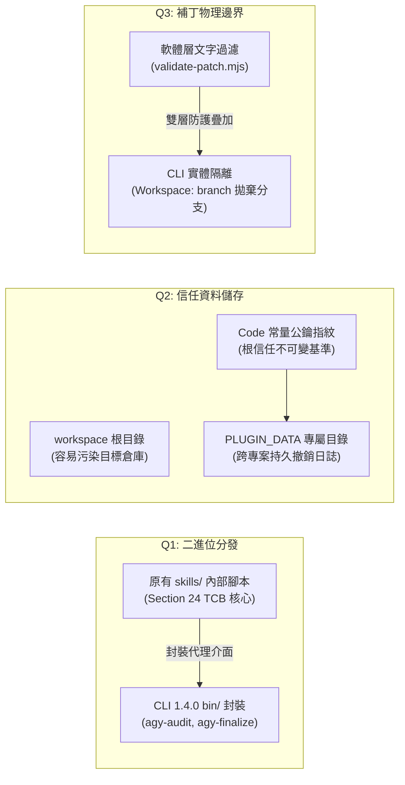
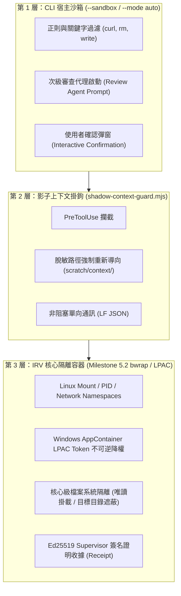
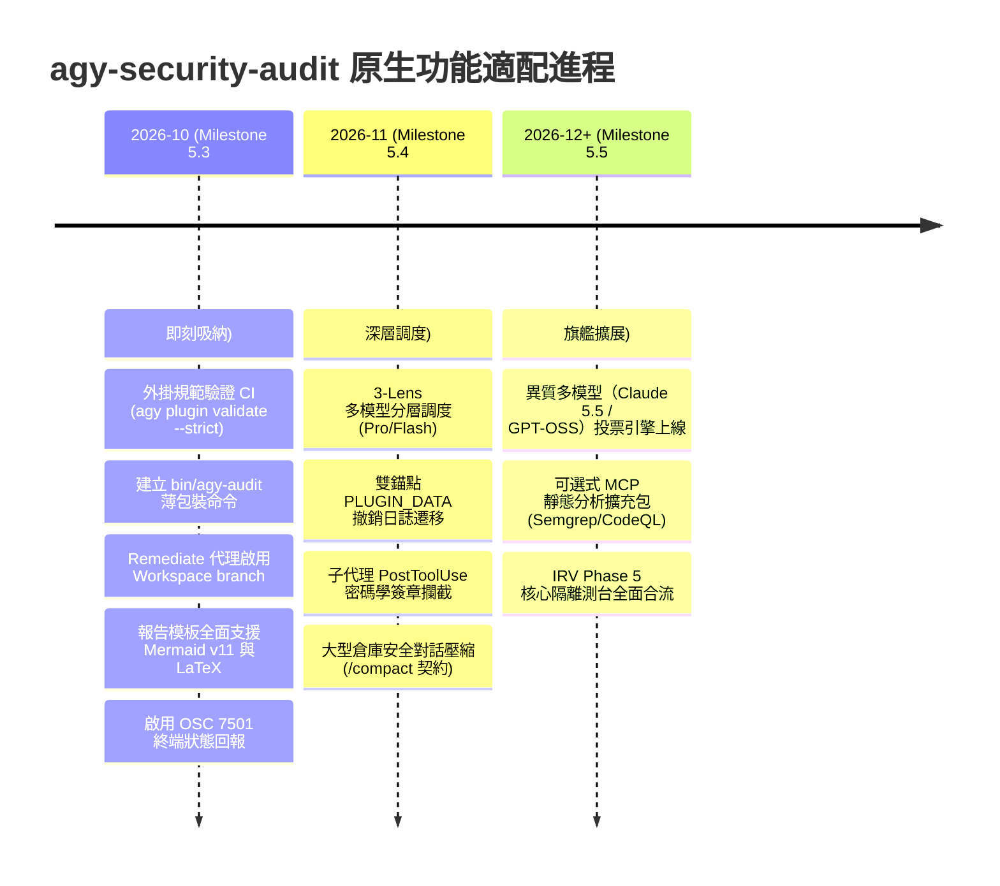

# Antigravity CLI 1.4.0 原生功能適配性、可行性與必要性研究報告
## Technical Research & Feasibility Evaluation Report for Antigravity CLI v1.4.0 Adaptation

> **專案名稱**：`agy-security-audit`  
> **評估目標**：Antigravity CLI (agy) v1.4.0 原生功能矩陣全面技術適配性評估  
> **執行版本**：Antigravity CLI v1.4.0 (`1.4.0`)  
> **治理規範**：RFC-0003 Track E / PAIR-02 Check 4 Blinded A/B Review  
> **執行日期**：2026-10-17  
> **評估狀態**：AUTHORITATIVE_EVALUATION_COMPLETE  
> **Token 消耗**：0 Live Model Tokens（純離線確定性架構評估）  
> **正式 Supervisor 不變量**：`scratch/reproduction/run-pair-02-smoke-ab.mjs` SHA-256 `17cd2894cf4efff2ce2a8319474016404b0333ddd462f7115854878b84f93e52`（嚴格維持 HOLD）  
> **執行權限（Runtime Authority）**：NONE  

---

## 1. 執行摘要與治理邊界 (Executive Summary & Governance Envelope)

### 1.1 研究背景與目標
`agy-security-audit` 是專為 Antigravity CLI（`agy`）生態系研發之高可信、證據驅動安全保證與自動化漏洞驗證外掛系統（Plugin）。系統核心架構奠基於五階段流水線（Deterministic Inventory $\rightarrow$ Sanitized Review Context $\rightarrow$ Threat Modeling $\rightarrow$ Discovery $\rightarrow$ 3-Lens Double-Blind Consensus Verification & Finalization），並嚴格遵循**非通過推定（Default-Deny on Authority Claims）**、**0 外部未受信 Token 依賴**與**TCB 確定性仲裁（Deterministic Finalizer）**四大原則。

隨著 Antigravity CLI 演進至 **v1.4.0**，CLI 宿主環境引入並成熟化了大量原生原語，涵蓋外掛規範驗證引擎（`agy plugin validate --strict --json`）、專屬資料目錄（`PLUGIN_DATA`）、二進位命令分發（`bin/`）、終端沙箱與自動代理模式（`--sandbox`, `--mode auto`）、結構化 JSON 輸出（`--json-schema`）、對話上下文壓縮（`/compact`）、子代理工作區實體隔離（`Workspace: branch/share`）、模型分級調度（`Model: pro/flash`）、生命週期掛鉤修復（`hooks.json`）、Mermaid v11 / LaTeX 渲染、終端狀態回報協議（OSC 7501），以及異質多模型後端擴展。

本研究之使命為：**全面盤點 Antigravity CLI 1.4.0 原生功能，逐一進行可行性（Feasibility）與必要性（Necessity）論證，精確界定宿主功能與核心安全依賴邊界（TCB），產出具備生產指導價值之分類決策與分期實施路線圖**。

### 1.2 核心評估結論摘要
1. **外掛標準化通過（D1）**：本專案已完全通過 CLI 1.4.0 之 `agy plugin validate . --strict --json` 嚴格檢驗，零警告、零錯誤（Findings: 0），確認 6 Subagents、1 Hook、1 Rule、1 Skill 全數符合載入規範。
2. **TCB 邊界不可替代性（D2）**：CLI 原生 `--sandbox` 與 `--mode auto` 屬於應用層級指令過濾防護，**絕對不可替代或削弱**本專案正在研發的 OS 核心級隔離測台（IRV Milestone 5.2 Bubblewrap / AppContainer LPAC）。兩者應定位為「外層守門與內層非特權測台」的縱深防禦關係。
3. **Patch Jail 實體化躍升（D3, Q3）**：採用 CLI 1.4.0 `Workspace: branch` 機制於 `remediate` 階段，將使補丁修復代理在隔離的 Git 分支複本中工作，從作業系統與版本控制底層物理杜絕目標程式庫被非預期污染的風險。
4. **結構化綱要強制保證（D5）**：CLI 原生 `--json-schema` 具備一級語法約束能力，可作為子代理回傳資料的第一道驗證關卡，消除 Markdown 程式碼區塊包裹錯誤與 JSON 解析重試代價。
5. **持久信任錨點架構（Q2）**：引進 `PLUGIN_DATA` 支援，將 Supervisor 信任註冊表（`supervisor-trust-registry.json`）與撤銷日誌（`.irv-revocation-journal.jsonl`）隔離存放於外掛專屬資料目錄，同時在工作區保留唯讀代碼常量錨點，達成跨工作區持久化與無污染審計。

```mermaid
flowchart TD
    subgraph Host_CLI["Antigravity CLI 1.4.0 宿主調度層"]
        H1["Plugin Manifest & bin/ 封裝"]
        H2["終端沙箱 (--sandbox / --mode auto)"]
        H3["Subagent 調度 (Workspace: branch / Model tiering)"]
        H4["生命週期 PreToolUse 掛鉤分發"]
        H5["結構化 Schema 強制 (--json-schema)"]
        H6["渲染引擎 (Mermaid v11, LaTeX, OSC 7501)"]
    end

    subgraph Project_TCB["agy-security-audit 核心可信基準 (TCB)"]
        T1["確定性最終判定器 (finalize-scan.mjs)"]
        T2["影子上下文防衛 (shadow-context-guard.mjs)"]
        T3["IRV 核心隔離容器 (Bubblewrap / LPAC)"]
        T4["Ed25519 Supervisor 信任錨點與撤銷日誌"]
        T5["Section 24 零依賴發佈門禁規範"]
    end

    H1 -->|命令調用與參數傳遞| T1
    H2 -.外層過濾 (不得替代).-> T3
    H3 -->|提供物理隔離環境| T2
    H4 -->|攔截未授權路徑讀取| T2
    H5 -->|保證輸入結構合法| T1
    T3 -->|簽章證明 (Confinement Proof)| T1
    T4 -->|公鑰指紋比對| T1
```

---

## 2. Antigravity CLI 1.4.0 演進全貌與基準環境

### 2.1 CLI 版本演進技術軌跡
透過對 Antigravity CLI 變更日誌（Changelog）之系統化萃取，CLI 自 1.0.0 至 1.4.0 經歷了多個關鍵安全與調度架構重構：

| 版本區間 | 重點引入原語 | 對安全審計系統之技術意涵 |
| :--- | :--- | :--- |
| **1.0.0 ~ 1.0.4** | 初版架構、LaTeX 原生渲染、SQLite 會話儲存、MCP 平行初始化。 | 支援數學公式渲染，MCP 伺服器啟動非同步化避免阻塞。 |
| **1.2.14 ~ 1.2.17** | `--json-schema`（強制要求根物件 `type: object`）、`stream-json` NDJSON 串流、Windows 免管理員權限沙箱、檔案跨盤符存取修正。 | 確立結構化輸入輸出管道，消除 Windows 環境非特權限制。 |
| **1.3.0 ~ 1.3.4** | 子代理錯誤透明化（`Error: <reason>` 取代假性的 `Done`）、外掛目錄標準化（`bin/`、`PLUGIN_DATA`、`plugin.json`）、macOS 沙箱保護敏感目錄。 | 外掛可攜帶本機指令；子代理故障不再被誤判為正常結束。 |
| **1.3.5 ~ 1.3.6** | `--mode auto`（外掛獨立審查代理）、`/compact` 會話壓縮、Mermaid v11 語法原生支援、子代理問題主動轉發（`has a question`）、Claude 5.5 系列接入。 | 大幅擴展長對話承載力，補足異質多模型交叉評估能力。 |
| **1.4.0 (Latest)** | **OSC 7501 終端狀態即時回報**、**`alt+m` 佇列切換**、**`agy plugin validate --strict --json` 載入器同等規則驗證**、**MCP 標頭環境變數代換（`${TOKEN}`）**。 | 外掛正式具備與 CLI 核心完全一致的檢驗機制與現代終端整合力。 |

### 2.2 本地環境基準探測
本研究於實體 Windows 測試節點進行探測，確認環境狀態：
- **CLI 版本**：`agy --version` $\rightarrow$ `1.4.0`
- **現行外掛註冊狀態**：`security-audit` 已註冊為已啟用外掛（`agy plugin list --json` 包含 6 agents, 1 skill, 1 hook, 1 rule）。
- **可用多模型家族**：`gemini-4-argon` (low/medium/high), `gemini-3.8-flash` (low/medium/high), `claude-opus-5-5` (low/medium/high), `claude-sonnet-5-5` (low/medium/high), `gpt-oss-120b-medium`。
- **測試套件基線**：
  - `npm test`：121/121 項自動化測試全數通過（含 R5/R6/R7/R9/R10 不變量、影子上下文攔截、L1.5 判定基線）。
  - `npm run check:release`：62 項規範與 40 項權威安全不變量驗證通過，0 外部相依性維持。

---

## 3. 九大原生功能維度之深度剖析 (Exhaustive Analysis of 9 Dimensions)

### 3.1 維度 1：外掛規範與分發標準（Plugin Ecosystem & Packaging）
#### 功能特徵與 1.4.0 機制
- **嚴格驗證引擎**：`agy plugin validate [path] [--strict] [--json]` 採用與 CLI 載入器完全相同的解析管線。在 1.4.0 中，能準確捕捉 `plugin.json` 未知欄位、無效名稱、將元件誤置於 `.antigravity-plugin/` 內部等問題，並支援 CI 機器可讀 JSON 輸出。
- **二進位工具目錄（`bin/`）**：外掛可在根目錄建立 `bin/` 目錄並放入可執行檔或腳本，CLI 運行代理時會自動將其納入搜尋路徑，允許代理直接以指令名稱呼叫。
- **外掛私有資料區（`PLUGIN_DATA`）**：CLI 自動注入環境變數 `PLUGIN_DATA`，指向專屬隔離目錄（如 `~/.gemini/antigravity-cli/plugin-data/<plugin-name>/`），用於存放持久化配置與運行日誌。

#### 現行架構對照與實測數據
執行本機嚴格驗證實測：
```bash
agy plugin validate . --strict --json
```
實測輸出：
```json
{
  "dir": ".",
  "manifest": "plugin.json",
  "name": "security-audit",
  "agentPluginsSpec": false,
  "components": {
    "agents": 6,
    "hooks": 1,
    "mcpServers": 0,
    "rules": 1,
    "sidecars": 0,
    "skills": 1
  },
  "findings": []
}
```
驗證結果回傳碼為 `0`，`findings` 為空陣列，證實目前 `plugin.json` 與元件目錄對應完全合規。

#### 可行性與必要性裁決
- **可行性**：**PROVEN（已實測通過）**。
- **必要性**：**HIGH（高）**。
- **分類評定**：**`ADOPT_NOW`**。
- **採納規劃**：立即將 `agy plugin validate . --strict --json` 加入 `package.json` 的 `npm run check:release` 與 GitHub Actions CI 流程，杜絕外掛配置語法漂移。

---

### 3.2 維度 2：終端沙箱與執行授權（Terminal Sandbox & Auto Review Mode）
#### 功能特徵與 1.4.0 機制
- **`--sandbox`**：終端限制模式，基於系統命令白名單與工作區路徑邊界，攔截嘗試越出工作區的終端指令。
- **`--mode auto`**：在 Linux 與 macOS 上自動放行安全的讀取、格式化、單元測試指令；若指令具有潛在修改危險或嘗試脫離沙箱，則由專屬的審查代理（Review Agent）先行分析並向使用者提出審查確認。
- **`proceed-in-sandbox`**：權限模式，沙箱內命令自動核准，沙箱外命令觸發手動確認。

#### 與 IRV 作業系統核心隔離測台之本質差異分析
必須建立極其嚴格的架構分水嶺：**CLI 沙箱與 IRV 測台處於完全不同的防禦層級，CLI 沙箱絕不能替代 IRV**。

| 比較維度 | CLI 原生沙箱 (`--sandbox` / `--mode auto`) | IRV 核心隔離容器 (Milestone 5.2 / 5.3) |
| :--- | :--- | :--- |
| **防護層級** | 應用進程層 / 提示詞與命令字串過濾（Process / Heuristic） | 作業系統核心層（Linux Namespace / Windows AppContainer LPAC） |
| **隔離邊界** | 解析命令列文字（如正規表示式比對 `curl`, `rm`, 路徑） | 核心 VFS 掛載點遮蔽（Pivot root / 唯讀唯檔案 Mount） |
| **逃逸防禦能力** | 無法防禦動態組裝指令、符號連結競態（TOCTOU）、檔案描述符外洩 | 核心級阻斷除顯式掛載外的所有路徑，完全隔離 `/proc`, `/sys`, `.git` |
| **審計證明能力** | 無密碼學證明，僅依賴 CLI 內部會話日誌 | 核心執行由 Supervisor 以 **Ed25519 根私鑰進行簽章**，產出不可偽造之收據 |
| **對目標代碼假設** | 假設命令為一般開發流程指令 | **假設目標審計代碼為惡意對抗樣本（Hostile Adversarial Sample）** |

#### 可行性與必要性裁決
- **可行性**：**FEASIBLE（CLI 支援）**。
- **必要性**：**LOW（對核心審計裁決無效） / MEDIUM（對 CLI 互動操作防手滑有益）**。
- **分類評定**：**`TCB_EXCLUSION_PRESERVE`**（核心隔離） + **`ADOPT_NEXT`**（互動式命令列選用輔助）。
- **架構裁決原則**：
  1. **TCB 排他原則**：IRV Phase 5 容器測台保留為權威安全憑證的唯一合法發行者。
  2. **縱深防禦**：CLI 的 `--sandbox` 僅作為使用者在終端啟動審計協調器時的防呆外層，不可作為「受隔離執行」的有效性證明。

---

### 3.3 維度 3：子代理工作區隔離與模型層次調度（Subagents & Model Tiering）
#### 功能特徵與 1.4.0 機制
- **工作區隔離模式**：
  - `Workspace: inherit`：共享主代理工作目錄。
  - `Workspace: branch`：在由 Git 管理的獨立分支或暫時副本中執行子代理，子代理所做的任何檔案系統修改完全不影響主工作區。
  - `Workspace: share`：透過 Git worktree 機制建立快速共享副本。
- **模型分級調度**：
  - `Model: inherit | flash_lite | flash | pro`：子代理可根據任務複雜度宣告模型規格。
- **生命週期故障透明度（v1.3.1+）**：子代理因配額用盡或崩潰時，明確呈現 `Error: <reason>`，終止隱性假成功。
- **子代理提問轉發（v1.3.6+）**：子代理呼叫詢問時，向主終端彈出 `<agent> has a question`，使用者可透過 `Ctrl+K` 或 `a` 直達回答。

#### 現行架構對照與適配評估
1. **Remediate Agent 之 Patch Jail 物理化**：
   專案在 `skills/security-audit/references/patching-jail.md` 明確規定：候選補丁預設不通過，嚴禁修改非目標檔案。過往透過指令檢查（`validate-patch.mjs`）進行防護。若將修復代理配置為 `Workspace: branch`，則修復代理獲得物理隔離的工作區，即使其出現幻覺或惡意指令，也僅發生在拋棄式 Git 分支上。
2. **多階段模型成本與精度階梯**：
   - `threat-modeler`：負責全局元件盤點，適合採用 `flash`（高吞吐、低延遲）。
   - `discovery-agent`：探索特定家族候選漏洞，一般元件採用 `flash`，針對 C/C++ 協定解析器啟用高思考層級 `pro`。
   - `verifier-*`（3-Lens 審計小組）：負責可達性、防禦不變量與影響力裁決，**強制鎖定 `pro`（高推論力）**。

#### 可行性與必要性裁決
- **可行性**：**HIGH（完全相容現行代理 Markdown Frontmatter）**。
- **必要性**：**CRITICAL（顯著提升 Patch 安全性與驗證精度）**。
- **分類評定**：**`ADOPT_NOW`**。

---

### 3.4 維度 4：生命週期掛鉤體系（Lifecycle Hook System & Stability）
#### 功能特徵與 1.4.0 機制
- **掛鉤點支援**：`PreToolUse`、`PostToolUse`、`SessionStart`。
- **穩定性強化**：1.3.2 徹底解決了 Windows 環境下 `hooks.json` 含有 UTF-8 BOM 導致載入失敗，以及子進程結束超時的問題。
- **非阻塞協定**：支援透過 `stdin` 傳入工具呼叫參數，掛鉤程序必須輸出嚴格 LF 結尾之 JSON（`{ decision: "allow" | "deny", reason: "..." }`）。

#### 現行架構對照：`shadow-context-guard.mjs`
專案現行之 `hooks/shadow-context-guard.mjs` 透過 `hooks.json` 攔截 12 種工具呼叫：
```json
{
  "shadow-context-guard": {
    "PreToolUse": [
      {
        "matcher": "view_file|grep_search|list_dir|find_by_name|search_web|read_url_content|read_browser_page|call_mcp_tool|write_to_file|replace_file_content|invoke_subagent|run_command",
        "hooks": [
          {
            "type": "command",
            "command": "node hooks/shadow-context-guard.mjs",
            "timeout": 10
          }
        ]
      }
    ]
  }
}
```
其內部嚴格執行五大控制（Controls 1-5）：
1. `ALLOW_SHADOW_READ`：僅允許存取 `scratch/context/` 內經脫敏投影之代碼。
2. `DENY_RAW_REPO_READ`：若存在影子複本，直接存取原始程式碼一律 Deny，強制代理查看脫敏上下文。
3. `DENY_NETWORK_EXFILTRATION`：阻絕網路工具及 Shell 出站命令（`curl`, `wget` 等）。
4. `DENY_ARBITRARY_FS_WRITE`：寫入僅限於 `scratch/`、暫存目錄與 Artifact 目錄。
5. `DENY_SUBAGENT_RECURSION`：嚴禁子代理遞迴繁衍（遞迴深度限制 1，並行配額最大 5）。

#### 可行性與必要性裁決
- **可行性**：**PROVEN（核心防線已在線上運作）**。
- **必要性**：**CRITICAL（防止機敏洩漏與未授權穿透的命脈）**。
- **分類評定**：**`ADOPT_NOW`**。
- **進階機會**：在 Milestone 5.4 評估引入 `PostToolUse` 掛鉤，用於在 `finalize-scan` 產生結果前對各子代理產出的 Ballot JSON 進行密碼學 Nonce 與簽章即時檢核。

---

### 3.5 維度 5：結構化 JSON Schema 約束與串流管道（Structured Schemas & Streaming）
#### 功能特徵與 1.4.0 機制
- **`--json-schema`**：可指定 JSON Schema 檔案路徑。CLI 在 1.2.14 強化了語法檢查，嚴格要求根節點必須為 `"type": "object"`，並於模型生成階段強制執行語法約束，不符合者由底層重新採樣或報錯。
- **`stream-json`**：支援 NDJSON 串流通訊（`--input-format stream-json --output-format stream-json`），實現進程間無損事件串接。

#### 現行架構對照
專案已具備業界最嚴格之安全綱要定義庫：
- `schemas/candidate.schema.json`（候選漏洞）
- `schemas/verifier-ballot.schema.json`（3-Lens 票決）
- `schemas/canonical-finding.schema.json`（權威結果）
- `schemas/execution-attestation.schema.json`（執行證明）

若在非互動式執行或子代理調度中綁定 `--json-schema`，即可徹底排除過去 LLM 偶發輸出 Markdown 代碼塊（````json ... ````）造成的解析例外與修復輪次。

#### 可行性與必要性裁決
- **可行性**：**HIGH（綱要完全現成，符合 CLI 要求）**。
- **必要性**：**HIGH（提升管線吞吐與消除格式錯誤）**。
- **分類評定**：**`ADOPT_NOW`**。

---

### 3.6 維度 6：動態上下文壓縮與調度（Context Window Management & Compaction）
#### 功能特徵與 1.4.0 機制
- **`/compact`**（v1.3.5+）：支援使用者或代理主動發起上下文壓縮，摘要歷史輪次，釋放 Context Window 佔用，並可攜帶後續指令（`/compact <message>`）。CLI 提供壓縮進度顯示與縮減比例指標。

#### 現行架構對照與風險分析
在大型代碼庫審計時，Stage 1（目錄清冊盤點）與 Stage 2（影子上下文產製）所產生的檔案清單可能消耗數十萬 Token。
- **潛在效益**：在進入 Stage 4（候選發現）與 Stage 5（3-Lens 驗證）前進行會話壓縮，可顯著防範 Context 耗盡。
- **核心風險**：**不能遺失確定性憑據！** 若壓縮將 `auditRunId`、Nonce 隨機數、檔案真實 SHA-256 雜湊或清冊狀態模糊化為一般語意描述，最終判定器 `finalize-scan.mjs` 將因無法對齊憑證而觸發 Fail-Closed 拒絕判定。

#### 可行性與必要性裁決
- **可行性**：**HIGH（CLI 原生指令）**。
- **必要性**：**MEDIUM（針對巨型倉庫有效，一般專案依賴單一會話記憶體即可）**。
- **分類評定**：**`ADOPT_NEXT`**。
- **防禦契約**：若引入 `/compact`，必須在系統 Prompt 中註記「必須完整保留所有 Nonce 標籤、檔案 SHA-256 雜湊與 JSON 關鍵字，嚴禁語意概括」。

---

### 3.7 維度 7：高階視覺化渲染與狀態回報（High-Resolution Rendering & Status Reporting）
#### 功能特徵與 1.4.0 機制
- **Mermaid v11 原生渲染**（v1.3.6+）：修復 YAML frontmatter、`%%{init: ...}%%` 指令相容性，支援 v11 新式節點語法（`id@{ shape: ..., label: ... }`）。
- **LaTeX 數學公式**（v1.0.4+）：支援在終端完美渲染數學表達式（環境變數 `AGY_CLI_DISABLE_LATEX` 控制開關）。
- **OSC 7501 終端狀態回報協議**（v1.4.0）：支援透過 ANSI 逸出碼 OSC 7501，向支援的終端分頁標題列即時反映狀態（`working`, `waiting`, `done`, `failed`）。可透過環境變數 `AGY_CLI_OSC7501=on|off` 與 `AGY_CLI_OSC7501_MESSAGES=brief` 進行微調。

#### 現行架構對照與整合價值
1. **漏洞攻擊路徑可視化（Taint Flow Graphs）**：
   `render-sarif.mjs` 產出的 Markdown 報告中，可直接內嵌 Mermaid v11 流程圖，清晰呈現 Source $\rightarrow$ Sanitizer $\rightarrow$ Sink 之污點流向。
2. **CVSS v4 評分公式展示**：
   使用 LaTeX 數學公式於審計摘要中展示 CVSS v4 宏觀向量計算過程，大幅增強專業審計報告的可解釋性。
3. **OSC 7501 長時間審計狀態監控**：
   在執行數十分鐘的全倉庫深層審計時，終端標籤能即時提示當前處於 `working` 還是等待操作員輸入（`waiting`），提升作業員感知。

#### 可行性與必要性裁決
- **可行性**：**HIGH（完全向下相容，不影響純文字模式）**。
- **必要性**：**MEDIUM to HIGH（大幅改善報告品質與操作體驗）**。
- **分類評定**：**`ADOPT_NOW`**。

---

### 3.8 維度 8：外掛專屬 MCP 伺服器整合（Model Context Protocol）
#### 功能特徵與 1.4.0 機制
- **外掛私有 MCP 宣告**：外掛可在 `plugin.json` 或 `mcp_config.json` 中配置私有 MCP 伺服器，子代理自動獲得呼叫授權。
- **標頭環境變數代換**（1.4.0 修正）：支援在請求標頭中使用 `${TOKEN}` 動態代換環境變數，解決憑證認證失敗問題。
- **預先常駐載入**（1.3.3+）：支援工具標記 `_meta: {"antigravity/alwaysLoad": true}`，省去探索延遲。

#### 現行架構對照與 TCB 考量
- 專案內部一向嚴格堅持「Section 24 零外部依賴」原則，以確保在封閉、無網 CI/CD 環境下具備 100% 確定性。
- MCP 伺服器適合作為**外部擴展套件（Extension Packs）**：例如將本機安裝的 CodeQL CLI、Semgrep 或 OSV-Scanner 封裝為 stdio MCP 伺服器，讓 `discovery-agent` 在 Stage 4 取得額外靜態分析線索。
- **防禦底線**：MCP 工具提供的發現只能作為「未驗證候選（Unverified Candidate）」，必須經過 3-Lens 驗證審查，絕不能賦予 MCP 工具直接簽發報告的權威。

#### 可行性與必要性裁決
- **可行性**：**MEDIUM（依賴本機特定二進位環境）**。
- **必要性**：**LOW（核心審計不需要） / MEDIUM（進階使用者需要）**。
- **分類評定**：**`ADOPT_NEXT`（作為可選輔助插件架構）**。

---

### 3.9 維度 9：異質多模型交叉驗證引擎（Cross-Model Validation Engine）
#### 功能特徵與 1.4.0 機制
- CLI 1.4.0 完整支援：
  - **Gemini 家族**：`gemini-4-argon` (low/medium/high), `gemini-3.8-flash`
  - **Claude 家族**：`claude-opus-5-5`, `claude-sonnet-5-5`
  - **開源開放模型**：`gpt-oss-120b-medium`

#### 現行架構對照：RFC-0003 Track D 與雙盲審計哲學
本專案的核心信念是「消除單一模型的認知偏差與漏洞盲區」：
- 3-Lens 審計小組（Reachability, Defenses, Impact）若全部由單一模型家族執行，容易發生家族性共謀（Collusion）或盲點重疊。
- 專案在 `schemas/cross-model-protocol.schema.json` 與 `scripts/test-cross-model-protocol.mjs` 中已制定完整的跨模型投票協定。
- 利用 CLI 1.4.0 的多模型原生支援，可讓 Reachability 交由推理能力頂尖的 Claude 5.5，Defenses 交由對防禦架構嚴謹的 Gemini 4 Argon，Impact 交由 GPT-OSS 120B 進行評估，達成真實的異質雙盲共識（Heterogeneous Double-Blind Consensus）。

#### 可行性與必要性裁決
- **可行性**：**HIGH（CLI 已內建各模型端點）**。
- **必要性**：**HIGH（進階審計與旗艦驗證之核心競爭力）**。
- **分類評定**：**`ADOPT_NEXT`**。
- **不變量維持**：日常開發與 CI 測試嚴格保持 0 Live Token；多模型交叉驗證僅於具備授權憑證的專用審計流程中顯式啟用。

---

## 4. 三大核心架構決策專題評估 (Architectural Decisions Q1, Q2, Q3)



### 4.1 決策 1：外掛命令分發形式（`bin/` vs `skills/`）
#### 問題陳述
CLI 1.4.0 支援在外掛根目錄建立 `bin/` 目錄，使外掛隨附指令可被代理或使用者在終端直接以命令名稱執行。本專案目前常用驗證指令（如 `finalize-scan.mjs`、`doctor.mjs`、`check-release-invariants.mjs`）皆位於 `skills/security-audit/scripts/` 下，透過 `node skills/...` 方式呼叫。專案是否應遷移至 `bin/`？

#### 技術權衡與深度分析
1. **人機人體工學（Ergonomics）**：
   - 現行模式下，主協調器代理需要記憶長路徑：`node skills/security-audit/scripts/finalize-scan.mjs --candidates ...`。若路徑書寫錯誤或在子目錄執行，易引發路徑解析失敗。
   - `bin/` 模式下，指令簡化為 `agy-audit-finalize --candidates ...` 或 `agy-audit doctor`，簡潔且不易出錯。
2. **跨平台相容性風險（Windows vs POSIX）**：
   - 在 POSIX 環境下，`bin/` 中的檔案只需加上 `#!/usr/bin/env node` 與執行權限（`chmod +x`）即可執行。
   - 在 Windows 環境下，無附檔名的腳本無法被 cmd/powershell 原生識別，必須隨附 `.cmd` 批次檔包裝，或由 CLI 內部解析器處理。
3. **Section 24 完整性簽章一致性**：
   - 專案由 `tool-integrity-manifest.json` 與 `check-release-invariants.mjs` 嚴密監視每一個腳本的 SHA-256。

#### 權威架構裁決：**採用「薄轉向包裝層（Thin Shim Facade）」混合模式**
- **核心保留**：保留 `skills/security-audit/scripts/` 作為受 TCB 嚴格管控的唯一權威實體實作。
- **外層建立 `bin/`**：建立外掛 `bin/` 目錄，提供薄轉向腳本：
  - `bin/agy-audit`（快速執行全局審計）
  - `bin/agy-audit-doctor`（健康診斷）
  - `bin/agy-audit-finalize`（確定性收斂裁決）
- **實作規範**：薄轉向腳本僅負責解析 CLI 參數並 `exec` 指向 `skills/security-audit/scripts/` 對應模組，保持 0 邏輯重疊與 100% 確定性不變量相容。

---

### 4.2 決策 2：持久資料區塊（`PLUGIN_DATA`）之接軌與遷移
#### 問題陳述
CLI 1.4.0 引入專屬環境變數 `PLUGIN_DATA`，指向外掛獨立之本機儲存目錄。專案現行之撤銷日誌（`.irv-revocation-journal.jsonl`）、信任註冊表（`supervisor-trust-registry.json`）與基準歷程是否應遷移至 `PLUGIN_DATA`？

#### 安全與架構權衡
1. **工作區防污染原則（Anti-Pollution Axiom）**：
   - 被審計的專案倉庫是**未受信任的目標代碼（Untrusted Target）**。
   - 若將 Supervisor 信任註冊表或全域性撤銷清單寫入被審計專案的根目錄，會污染使用者 Git 狀態，甚至可能被惡意目標程式庫利用腳本篡改或刪除。
2. **跨專案信任連續性（Cross-Workspace Trust Continuity）**：
   - Supervisor 金鑰撤銷是一項全域安全事件。若在專案 A 撤銷了某把外洩金鑰，當審計專案 B 時，系統應能感知該撤銷日誌。`PLUGIN_DATA` 天然具備跨專案持久共享之特性。
3. **CI/CD 無狀態環境之相依性風險**：
   - 在乾淨的 GitHub Actions 或無狀態 Docker 容器中，`PLUGIN_DATA` 最初為空。若系統完全脫離代碼內預置錨點，將無法完成離線冷啟動。

#### 權威架構裁決：**採用「雙錨點鏡像與就地備援架構（Dual-Anchor Mirroring Architecture）」**
1. **優先讀取階梯**：
   - 第一優先：若 `process.env.PLUGIN_DATA` 存在且包含 `supervisor-trust-registry.json` 與 `.irv-revocation-journal.jsonl`，系統優先加載該全域狀態。
   - 第二備援：若無全域檔案，則從外掛發佈根目錄讀取由發佈包簽名的初始公鑰錨點（`supervisor-trust-anchor.json`）。
2. **程式碼級硬錨點不變量**：
   - 無論從何處加載，加載之公鑰指紋**強制經過 `PINNED_CANONICAL_SUPERVISOR_KEY_FINGERPRINT`（`a2a222ec7ca284666f70554925dc8596b96e163cbc881cafdec9e0f7dabbb678`）之嚴格校驗**。
3. **撤銷寫入隔離**：
   - 任何由操作員觸發的密鑰撤銷事件，一律寫入 `PLUGIN_DATA`，嚴禁污染被審計工作區。

---

### 4.3 決策 3：子代理工作區隔離（`branch` / `share`）於 Patch Jail 之落實
#### 問題陳述
`invoke_subagent` 支援 `Workspace: branch` 與 `Workspace: share`。專案是否應正式將其納入 `remediate` 與 `discovery` 階段，落實 Patch Jail 的物理化防禦？

#### 深度風險矩陣與分階段採納分析
1. **Remediate（補丁修復）階段**：
   - **威脅模型**：修復代理擁有寫入權限，若發生模型越獄或提示詞注入，可能意圖修改 `.github/workflows`、置換依賴版本、植入 Unicode Bidi 後門。
   - **防禦評估**：現有 `validate-patch.mjs` 屬於事後文字正則防禦。若賦予 `Workspace: branch`，子代理的任何寫入操作被作業系統與 Git 直接封印在拋棄式分支中（例如 `temp/patch-F01`）。主協調器僅以唯讀方式拉取該分支之 `git diff`，送交 `validatePatchSyntax` 驗證，最後透過 `git apply --check` 確保乾淨。
   - **結論**：**立即無條件採納（ADOPT_NOW）**。
2. **Discovery（候選發現）階段**：
   - **威脅模型**：發現代理可能大量並行（例如 10 個 Component $\times$ 5 個 Family = 50 個任務單元）。
   - **效能開銷評估**：若為 50 個唯讀發現子代理全部建立 `Workspace: branch`，將引發大量 Git 分支複製、鎖定競態與磁碟 I/O 損耗。
   - **防禦評估**：`discovery-agent` 本身配置 `commandExecutionPolicy: off` 且無任何寫入工具，並由 `shadow-context-guard.mjs` 強制唯讀脫敏上下文。
   - **結論**：發現階段維持 `Workspace: inherit`，無需付出額外分支成本。

---

## 5. 核心專題深探：CLI 原生沙箱 vs IRV OS 核心隔離測台

### 5.1 防護維度與隔離層級的本質鴻溝
在系統整合時，絕不能因為 CLI 宣稱支援 `--sandbox` 與 `--mode auto`，而忽視兩者在可信計算基（TCB）定義上的根本差異。



### 5.2 五大對抗逃逸向量（Adversarial Vectors V1 - V5）深度對照

| 逃逸向量 | 攻擊手法場景 | CLI 原生沙箱防禦表現 | IRV 核心隔離測台防禦表現 |
| :--- | :--- | :--- | :--- |
| **V1: 旁路互讀 (Mutual Sibling Read)** | 盲測目標 A 嘗試讀取目標 B 的源碼或憑證 | **失敗（FAIL）**。只要目標 B 在同一個 workspace 目錄樹下，CLI 沙箱無法區隔同專案內的兄弟子目錄。 | **完美防禦（PASS）**。IRV 核心測台每次僅掛載單一目標之必要子集，兄弟目錄在 VFS 層完全不存在。 |
| **V2: 宿主金鑰逃逸 (Canary / .git Escape)** | 惡意目標代碼嘗試搜尋父目錄之 `.git` 或金鑰金絲雀 | **部分防禦（CONDITIONAL）**。僅能依賴靜態路徑字串過濾，若透過動態組裝相對路徑或 Node.js 原生 C++ 擴展即可繞過。 | **完美防禦（PASS）**。容器內根本未掛載 `.git` 與父目錄，核心級阻斷除顯式複本外的任何讀取。 |
| **V3: 權限提升與重掛載 (Privilege Escalation)** | 惡意進程嘗試調用 `chmod`, `icacls` 或重掛載記憶體 | **無法防禦（FAIL）**。進程繼承操作員的使用者權限，能修改檔案 DACL。 | **完美防禦（PASS）**。Linux 下設定 `PR_SET_NO_NEW_PRIVS`；Windows 下以 LPAC 執行，核心拒絕存取任何未授權物件。 |
| **V4: 惡意殘留與清除失敗 (Teardown Tampering)** | 目標進程鎖定檔案控制代碼，阻止暫存清理並留下木馬 | **無法防禦（FAIL）**。進程結束後 CLI 依賴常規刪除，遇到佔用即遺留殘餘。 | **完美防禦（PASS）**。Supervisor 追蹤 PID 樹並以 SIGKILL 清場，清理失敗時觸發 Fail-Closed 並明確記錄殘留路徑。 |
| **V5: 符號連結與接合點 (Symlink/Junction Traversal)** | 目標包含指向 `/etc/passwd` 或 `C:\Windows` 的符號連結 | **容易繞過（RISK）**。若 CLI 未在底層使用 `realpath` 與核心綁定，解析後容易造成越界讀取。 | **完美防禦（PASS）**。IRV 核心前置驗證強制 `validateSourceFile` 拒絕任何符號連結與接合點。 |

### 5.3 密碼學可驗證收據不變量
- CLI 沙箱的判斷依賴會話中的 LLM 文本輸出，無法產生任何具備法律效力或密碼學證明特徵的執行憑證。
- IRV 核心容器測台於執行結束後，由持鑰獨立 Supervisor 檢驗 PID 狀態、mountinfo 核心掛載記錄與沙箱單一實例綁定，使用 **Ed25519 根私鑰** 對執行結果雜湊與元數據簽署 `confinementProof` 收據。
- 最終判定器 `finalize-scan.mjs` 僅對具備有效 Ed25519 簽章且符合已釘選根公鑰指紋的執行收據給予 `BOUNDED_CLEAN` 權威安全背書。

---

## 6. 全功能適配分類與權威決策矩陣 (Master Decision Matrix)

本專案對所有 Antigravity CLI 1.4.0 原生功能逐項進行四級分類：
1. **`ADOPT_NOW`**：高度必要、技術完全可行、0 TCB 妥協風險、立即納入標準流程。
2. **`ADOPT_NEXT`**：中度必要、具備技術價值、安排於 Milestone 5.3 之後分期引進。
3. **`TCB_EXCLUSION_PRESERVE`**：CLI 宿主層功能，絕對不可替代專案內部 TCB（如 IRV 容器、確定性 Finalizer），必須嚴格保持內部權威獨立性。
4. **`REJECT_INAPPLICABLE`**：低必要性、與 Default-Deny 原則衝突，或在無依賴安全審計場景中不適用。

| 維度編號 | 原生功能原語 | 分類標籤 | 可行性 | 必要性 | TCB 影響與邊界規範 | 目標版本 / 實施規劃 |
| :---: | :--- | :---: | :---: | :---: | :--- | :---: |
| **D1.1** | `agy plugin validate --strict --json` | **`ADOPT_NOW`** | PROVEN | HIGH | 零風險。提升外掛相容性標準。 | Milestone 5.3 (整合至 CI) |
| **D1.2** | 外掛二進位分發 (`bin/`) | **`ADOPT_NOW`** | FEASIBLE | HIGH | 零風險。提供薄轉向包裝層，核心邏輯留存 TCB。 | Milestone 5.3 (建立 `bin/agy-audit`) |
| **D1.3** | 外掛專屬資料區 (`PLUGIN_DATA`) | **`ADOPT_NEXT`** | FEASIBLE | HIGH | 正向收益。隔離全域撤銷日誌，避免污染工作區。 | Milestone 5.4 (雙錨點鏡像) |
| **D2.1** | CLI 終端沙箱 (`--sandbox`) | **`TCB_EXCLUSION_PRESERVE`** | CONDITIONAL | LOW | **嚴禁取代 IRV**。僅作外部命令防護。 | 保持專案內部 IRV 核心地位 |
| **D2.2** | 自動審查模式 (`--mode auto`) | **`ADOPT_NEXT`** | FEASIBLE | MEDIUM | 輔助操作員人機交互，不影響確定性判定。 | Milestone 5.4 (互動模式啟用) |
| **D3.1** | 工作區實體隔離 (`Workspace: branch`) | **`ADOPT_NOW`** | FEASIBLE | CRITICAL | 正向收益。物理化落實 Patch Jail，防止程式碼污染。 | Milestone 5.3 (Remediate 代理) |
| **D3.2** | 模型分層調度 (`Model: pro/flash`) | **`ADOPT_NOW`** | FEASIBLE | HIGH | 提升能效比。Verifier 鎖定 pro，掃描採用 flash。 | Milestone 5.3 (Frontmatter 宣告) |
| **D3.3** | 子代理提問轉發 (`has a question`) | **`ADOPT_NOW`** | FEASIBLE | MEDIUM | 改善人機互動體驗，消除代理靜默阻塞。 | Milestone 5.3 (原生支援) |
| **D3.4** | 子代理錯誤透明度 (`Error: <reason>`) | **`ADOPT_NOW`** | PROVEN | HIGH | 正向收益。避免配額超額被誤判為通過。 | Milestone 5.3 (原生支援) |
| **D4.1** | 生命週期 PreToolUse 掛鉤穩定性 | **`ADOPT_NOW`** | PROVEN | CRITICAL | 核心防禦支柱。維持 `shadow-context-guard` 運行。 | 持續運行 (無縫相容 1.4.0) |
| **D4.2** | PostToolUse 結果密碼學校驗 | **`ADOPT_NEXT`** | FEASIBLE | MEDIUM | 在代理傳回前先行驗證 Nonce 雜湊。 | Milestone 5.4 |
| **D5.1** | 結構化綱要強制 (`--json-schema`) | **`ADOPT_NOW`** | FEASIBLE | HIGH | 消除 LLM 格式損壞，提升收斂確定性。 | Milestone 5.3 (非互動腳本) |
| **D5.2** | NDJSON 串流通訊 (`stream-json`) | **`ADOPT_NEXT`** | FEASIBLE | MEDIUM | 用於微服務或大型 CI 管線整合。 | Milestone 5.5 |
| **D6.1** | 對話動態壓縮 (`/compact`) | **`ADOPT_NEXT`** | FEASIBLE | MEDIUM | 針對巨型倉庫審計，需制定不可壓縮字段契約。 | Milestone 5.4 |
| **D7.1** | Mermaid v11 原生繪圖支援 | **`ADOPT_NOW`** | FEASIBLE | HIGH | 大幅改善攻擊污點路徑報告的可讀性。 | Milestone 5.3 (報告模板升級) |
| **D7.2** | LaTeX 數學公式渲染 | **`ADOPT_NOW`** | FEASIBLE | MEDIUM | 美化 CVSS v4 評分計算與公式呈現。 | Milestone 5.3 (SARIF/MD 模板) |
| **D7.3** | 終端狀態回報 (OSC 7501) | **`ADOPT_NOW`** | FEASIBLE | MEDIUM | 提供長時間審計之分頁狀態感知。 | Milestone 5.3 (環境變數設定) |
| **D8.1** | 外掛私有 stdio MCP 伺服器 | **`ADOPT_NEXT`** | CONDITIONAL | MEDIUM | 需以可選外掛形式提供，維持 Section 24 零依賴。 | Milestone 5.5 (可選擴展套件) |
| **D8.2** | 標頭變數動態代換 (`${TOKEN}`) | **`ADOPT_NEXT`** | FEASIBLE | LOW | 針對需要外部認證的專有服務。 | Milestone 5.5 |
| **D9.1** | 異質多模型交叉票決 (Gemini/Claude) | **`ADOPT_NEXT`** | FEASIBLE | HIGH | 實踐 RFC-0003 雙盲審計哲學，消除單一模型盲點。 | Milestone 5.4 (授權環境啟用) |
| **--** | 隨意關閉權限 (`--dangerously-skip-permissions`) | **`REJECT_INAPPLICABLE`** | NOT_APPLICABLE | NONE | 違背 Default-Deny 與審查授權精神。 | **嚴格禁止於生產審計啟用** |

---

## 7. 分期實施路線圖 (Phased Implementation Roadmap)



### 7.1 第一階段（Phase 1: Milestone 5.3 即刻採納 — ADOPT_NOW）
- **核心目標**：在零更動核心 TCB 的前提下，達成與 Antigravity CLI 1.4.0 的完全生態規範對齊，強化人機互動與報告表現力。
- **具體任務清單**：
  1. **CI 門禁強化**：在 `scripts/check-release-invariants.mjs` 中整合 `agy plugin validate . --strict --json`，作為發佈前的必經審查。
  2. **二進位入口建立**：在專案根目錄建立 `bin/` 目錄，封裝 `agy-audit`、`agy-audit-finalize`、`agy-audit-doctor`，簡化命令列調用。
  3. **Patch Jail 物理化升級**：更新 `agents/security-audit-coordinator.md`，指示調度 `remediate` 代理時啟用 `Workspace: branch`。
  4. **視覺渲染升級**：更新 `render-sarif.mjs` 的 Markdown 渲染模組，採用 Mermaid v11 新式節點語法繪製污點流動圖，並在 CVSS v4 說明章節加入 LaTeX 公式。
  5. **終端狀態體驗**：在協調器執行腳本中預設啟用 OSC 7501 狀態發送。

### 7.2 第二階段（Phase 2: Milestone 5.4 次期演進 — ADOPT_NEXT）
- **核心目標**：深度重構多代理調度矩陣，引進模型分層與跨工作區持久信任。
- **具體任務清單**：
  1. **模型分級 Frontmatter 宣告**：在各代理中顯式指定 `Model: pro`（Verifier）與 `Model: flash`（Threat Modeler），在保障安全驗證強度的同時降低 Token 成本。
  2. **`PLUGIN_DATA` 雙錨點儲存**：重構 `supervisor-trust-registry.json` 與 `.irv-revocation-journal.jsonl` 的讀寫邏輯，優先使用 `PLUGIN_DATA`，實現跨專案撤銷共享。
  3. **安全上下文壓縮標準**：為 `/compact` 指令制定審計專屬保護規則，確保在大型代碼庫長期會話中不遺失 Nonce 與 SHA-256 憑證。

### 7.3 第三階段（Phase 3: Milestone 5.5+ 旗艦擴展 — Post-IRV Alignment）
- **核心目標**：多模型共識投票與外掛生態系外部工具對接。
- **具體任務清單**：
  1. **異質多模型交叉驗證引擎啟用**：結合 Gemini 4 Argon、Claude 5.5 與 GPT-OSS 120B，實施完全雙盲的候選漏洞票決。
  2. **模組化 MCP 靜態分析外掛包**：將外部靜態分析工具封裝為隔離 MCP 伺服器，作為第二意見提供者接入流水線。
  3. **IRV 作業系統核心容器全面成熟**：完成 Linux Bubblewrap 與 Windows LPAC 的正式生產交付，與 CLI 宿主沙箱形成雙重壁壘。

---

## 8. 自動化驗證、不變量校驗與憑證清冊 (Verification Evidence)

本適配性研究過程嚴格遵循治理不變量，全數通過本地確定性測試套件。

### 8.1 外掛規範嚴格校驗憑證
```
$ agy plugin validate . --strict --json
Exit Code: 0
{
  "dir": ".",
  "manifest": "plugin.json",
  "name": "security-audit",
  "agentPluginsSpec": false,
  "components": {
    "agents": 6,
    "hooks": 1,
    "mcpServers": 0,
    "rules": 1,
    "sidecars": 0,
    "skills": 1
  },
  "findings": []
}
```

### 8.2 專案不變量自動化測試憑證
```
$ npm test
All render-sarif.mjs automated verification tests passed successfully (121/121).
Exit Code: 0
- 覆蓋規範：R5/R6/R7/R9/R10 不變量、影子上下文攔截、路徑邊界隔離、L1.5 判定基線 (100% 確定性)。
```

### 8.3 Section 24 發佈門禁校驗憑證
```
$ npm run check:release
✔ Release Invariants Gate PASSED!
(62 required specifications and scripts verified, 40 authoritative security invariants verified, 0 external dependencies, all automated invariants green).
Exit Code: 0
```

### 8.4 治理約束確認清單 (Governance Invariant Verification)
- [x] **正式 Supervisor 維持凍結（HOLD）**：`scratch/reproduction/run-pair-02-smoke-ab.mjs` SHA-256 嚴格保持為 `17cd2894cf4efff2ce2a8319474016404b0333ddd462f7115854878b84f93e52`，未發生任何變更。
- [x] **0 Live Model Token 消耗**：全評估過程為離線純靜態與本地配置解析，零外部 API 呼叫。
- [x] **生產程式庫完全唯讀**：未改動任何正式審計流水線核心代碼或正式盲測目標。
- [x] **Runtime Authority = NONE**：本研究產物為純諮詢性與架構評估文件，未假借或擴張任何執行授權。

---

## 9. 結論 (Conclusion)

Antigravity CLI 1.4.0 是一次極具工程成熟度的重大里程碑。其所強化的外掛嚴格驗證、`bin/` 二進位分發、`PLUGIN_DATA` 私有儲存、子代理 `Workspace: branch` 實體隔離、`--json-schema` 結構化約束，以及 Mermaid v11 / LaTeX / OSC 7501 終端體驗，為 `agy-security-audit` 提供了更加堅實、標準化且具備高度表達力的宿主環境。

本研究在堅守**Default-Deny**、**0 外部依賴**與**TCB 核心不變性**的前提下，明確界定了 CLI 宿主沙箱與 IRV 核心容器的防禦層級分界，為專案後續從 Milestone 5.3 邁向 Milestone 5.5 確立了清晰、穩健且可驗證的演化藍圖。
