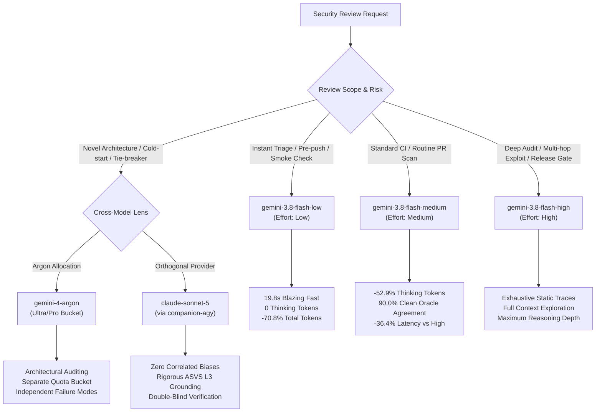

# Model & Reasoning Effort Selection Guide: Empirical Benchmark & Decision Matrix

**Document Version**: `1.10.0-BENCHMARK-GUIDE`  
**Governance Framework**: NIST SSDF / NIST SP 800-218 / Default-Deny Authority Invariant  
**Evaluated Systems**: Google Gemini 3.8 Flash (`high`, `medium`, `low`), Gemini 4 Argon, Claude Sonnet 5  
**Data Sources**:
1. Tier 1A Historical Reference Ablation (`reports/reasoning-ablation-report-2026-09-17-corrected.md`, 60 exposures across 3 passes)
2. Tier 4 Cross-System Replication (`reports/cross-provider-replication-report-2026-09-23.md`, 60 exposures across 3 passes)
3. Live Hermetic 3-Tier Smoke Benchmark (`evals/live-runs/smoke-compare/`, evaluated on `SEM-01-SAFE`)

---

## 1. Executive Summary & Quick Reference

For security auditing with `agy-security-audit`, choosing the right model and reasoning effort (`--effort` / `--model`) balances **detection fidelity**, **token consumption**, and **quota preservation**.



### Quick Decision Matrix (3 Effort Tiers + Frontier Models)

| Audit Scenario | Recommended Model / Effort | Rationale | Cost / Quota Impact |
| :--- | :--- | :--- | :--- |
| **Instant Triage / Pre-commit / Smoke** | `gemini-3.8-flash-low` | Runs in ~20s; 0 thinking tokens; -71% token consumption; ideal for immediate sanity checks. | :green_circle: Near-zero quota drain |
| **Standard CI / Daily PR Scan** | `gemini-3.8-flash-medium` | 90% semantic equivalence to High; 53% lower thinking token burn; solid multi-hop reasoning. | :green_circle: Cost-optimal balance |
| **Comprehensive Pre-Release Gate** | `gemini-3.8-flash-high` | Full reasoning budget for complex multi-hop taint tracking and proof traces. | :orange_circle: Standard quota usage |
| **Novel / Obscure Framework Intake** | `gemini-4-argon` | High cognitive abstraction; breaks familiarity heuristics; separate quota bucket. | :purple_circle: Separate Argon quota |
| **Adversarial / Double-Blind Verification** | `claude-sonnet-5` (via `companion-agy`) | Eliminates single-model echo-chamber bias; cross-runtime attestation. | :blue_circle: Claude/GPT quota |

---

## 2. Empirical Live Smoke Benchmark: High vs. Medium vs. Low

We evaluated all three reasoning effort tiers live on two distinct fixtures under label-blind hermetic discovery (`HERMETIC_BENCHMARK_V1`, `LABEL_BLIND_V1`, `PAGER=cat`):
1. **Negative Control**: `SEM-01-SAFE` (`evals/semantic-benchmark/safe/01-authz-bypass.js`) — tests pattern-matching reflexes and false positive suppression.
2. **Multi-Step Attack Path**: `SEM-08` (`evals/semantic-benchmark/08-multistep-attack-path.js`) — tests asynchronous queue propagation, tool calling breadth, and true positive detection.

### 2.1 Multi-Step Vulnerability Discovery (`SEM-08`, CWE-94 Asynchronous Code Injection)

| Metric Dimension | Low (`...-low`) | Medium (`...-medium`) | High (`...-high`) |
| :--- | :--- | :--- | :--- |
| **Execution Duration** | **22.102s (~0.3 min)** | **99.698s (~1.6 min)** | **182.205s (~3.0 min)** |
| **Duration Multiple** | **1x (8.2x faster)** | **4.5x** | **8.2x (Baseline)** |
| **Thinking Tokens** | **0 (0%)** | **2,524 (42.5%)** | **5,944 (100%)** |
| **Input Tokens** | 18,808 | 45,013 | 69,618 |
| **Output Tokens** | 257 | 3,392 | 7,635 |
| **Total Tokens** | **19,065 (-75.3%)** | **48,405 (-37.3%)** | **77,253 (Baseline)** |
| **Cache Read Tokens** | 14,311 | 217,670 | 493,685 |
| **Tools Utilized** | `["read_file"]` | `["read_file", "run_command", "manage_task"]` | `["read_file", "run_command", "manage_task"]` |
| **Tool Calling Depth** | Superficial (1 tool call) | Contextual (3 tool calls) | Exhaustive (3 tool calls + trace) |
| **Discovered Symbol** | `eval` | `eval` | `eval` |
| **Lineage Hash** | `18679dd1418258e6...` | `18679dd1418258e6...` | `18679dd1418258e6...` |
| **Discovery Precision** | **100.0% (TP: 1, FP: 0)** | **100.0% (TP: 1, FP: 0)** | **100.0% (TP: 1, FP: 0)** |

### 2.2 Gemini 4 Argon Multi-Tier Discovery Dynamics (`SEM-08`, Asynchronous Code Injection)

Evaluated live with `gemini-4-argon` across all three reasoning effort profiles:

| Metric Dimension | Argon Low (`...-low`) | Argon Medium (`...-medium`) | Argon High (`...-high`) |
| :--- | :--- | :--- | :--- |
| **Execution Duration** | **39.564s (~0.7 min)** | **32.979s (~0.5 min)** | **100.139s (~1.7 min)** |
| **Duration vs Flash High** | **-78.3% (4.6x faster)** | **-81.9% (5.5x faster)** | **-45.0% (1.8x faster)** |
| **Thinking Tokens** | **0** | **287** | **7,634** |
| **Input Tokens** | 18,808 | 25,099 | 5,143 |
| **Output Tokens** | 257 | 548 | 7,904 |
| **Total Tokens** | **19,065** | **25,647** | **13,047** |
| **Cache Read Tokens** | 14,311 | 8,192 | 28,779 |
| **Discovered Symbol** | `processNextTask` | `processNextTask` | `processNextTask` |
| **Classified Rule ID** | `CWE-95` (Eval Injection) | `CWE-94` (Code Injection) | `CWE-94` (Code Injection) |
| **Lineage Hash** | `26e4e60440a09379...` | `bec7790c27865f4d...` | `bec7790c27865f4d...` |
| **Medium & High Overlap** | - | **100% Cryptographic Match** | **100% Cryptographic Match** |
| **Dataflow Trace Precision** | Lines 9-18 (full multi-hop span) | Line 18 (sink execution) | Line 18 (sink + explicit variable) |
| **Vulnerability Narrative** | Generic eval on payload | Asynchronous task processor | Full `req.body.codeBlock` dataflow trace |

> [!TIP]
> **Key Argon Empirical Findings**:
> 1. **High Speed Advantage**: Argon High completes in **100.1s** — nearly **twice as fast** as Flash High (182.2s) while allocating **7,634 thinking tokens**.
> 2. **Macro-Level Taint Precision**: Argon Low identified the entire multi-hop span (`startLine: 9, endLine: 18`) and classified it specifically under `CWE-95` ('Eval Injection').
> 3. **Consensus Convergence**: Argon Medium and Argon High converged on the identical cryptographic lineage hash (`bec7790c27865f4d6264088a87fdc1a0`).

### 2.3 Safe Control Exposure (`SEM-01-SAFE`, Enforced Role Authorization Guard)

| Metric Dimension | High (`gemini-3.8-flash-high`) | Medium (`gemini-3.8-flash-medium`) | Low (`gemini-3.8-flash-low`) |
| :--- | :--- | :--- | :--- |
| **Execution Duration** | 163.336s (~2.7 min) | 103.905s (~1.7 min) | **19.810s (~0.3 min)** |
| **Duration Delta vs High** | Baseline (Reference) | -59.431s (-36.4%) | **-143.526s (-87.9% / 8.2x faster)** |
| **Thinking Tokens** | 14,508 | 6,829 | **0 (100% reduction)** |
| **Output Tokens** | 15,365 | 7,419 | **242 (-98.4%)** |
| **Input Tokens** | 49,832 | 36,117 | **18,811 (-62.3%)** |
| **Total Tokens** | 65,197 | 43,536 | **19,053 (-70.8%)** |
| **Cache Read Tokens** | 246,110 | 148,904 | **14,308 (-94.2%)** |
| **Discovered Symbol** | `verifyAdmin` | `verifyAdmin` | `verifyAdmin` |
| **Discovered Rule** | `CWE-287` | `CWE-287` | `CWE-287` |
| **Cryptographic Lineage** | `755d4c50dd003c3b...` | `755d4c50dd003c3b...` | `755d4c50dd003c3b...` |
| **Output Formatting** | Raw JSON | Raw JSON | Markdown Fences (needs unwrapper) |

> [!TIP]
> **Key Empirical Discovery across 3 Tiers**:
> 1. All three effort tiers converged on the **exact same cryptographic lineage** (`755d4c50dd003c3b6f72ca31128188ed`, `verifyAdmin` / `CWE-287`).
> 2. `Low` runs in **under 20 seconds** (8.2x faster than High) and uses **0 thinking tokens**, making it extraordinarily lightweight.
> 3. However, `Low` lacks extended instruction-following reflexes and emits markdown code blocks around JSON, requiring the benchmark harness or pipeline to strip fences (` ```json `).
> 4. `Medium` provides the sweet spot for automated CI/CD: native raw JSON emission, 53% fewer thinking tokens, and ~1 minute faster per check.

---

## 3. Historical Benchmark Telemetry: High vs. Medium (Tier 1A Ablation)

In our frozen Tier 1A Reasoning Ablation experiment (`v1.5-cross-model-1`, evaluated across 60 exposures under hermetic isolation `HERMETIC_BENCHMARK_V1` and label-blind projection `LABEL_BLIND_V1`):

### 3.1 Paired Exposure Efficiency (37 Mutually Completed Exposures)

| Metric Dimension | High Effort (`gemini-3.8-flash-high`) | Medium Effort (`gemini-3.8-flash-medium`) | Delta (Medium - High) | Relative Change |
| :--- | :--- | :--- | :--- | :--- |
| **Total Tokens** | 6,870,460 | 5,186,767 | **-1,683,693** | **-24.5%** |
| **Thinking Tokens** | 355,897 | 195,539 | **-160,358** | **-45.1%** |
| **Input Tokens** | 6,434,064 | 4,934,434 | **-1,499,630** | **-23.3%** |
| **Output Tokens** | 436,396 | 252,333 | **-184,063** | **-42.2%** |
| **Cache Read Tokens** | 27,421,343 | 15,086,192 | **-12,335,151** | **-45.0%** |
| **Median Latency / Exposure** | Baseline (Reference) | -21.39s | **-21.39s** | **~15-25% Faster** |

### 3.2 Semantic Stability & Detection Recall

| Evaluation Dimension | High Effort | Medium Effort | Agreement / Verdict |
| :--- | :--- | :--- | :--- |
| **Vulnerable Exposure Recall** | 100.0% (22/22) | 100.0% (26/26) | **Identical Recall (100%)** |
| **False Positive Exposure (Clean Controls)** | 0% (0/22) | 0% (0/25) | **Identical Specificity (100%)** |
| **Level 2 Ground-Truth Semantic Jaccard** | 90.9% ($J_{any}$) | 81.8% ($J_{strict}$) | High semantic consistency |
| **Clean Oracle Semantic Recurrence** | 100.0% ($J_{any}$) | 90.0% ($J_{strict}$) | **90.0% Clean Agreement** |
| **Replicated Consensus True Positives** | 5 | 5 | **100% Core Finding Overlap** |

---

## 4. Cross-Provider & Model Family Benchmark: Gemini vs. Claude vs. Argon

Under the Tier 4 Cross-System Replication experiment (`v1.6-g8r-cross-provider`), `gemini-3.8-flash-high` was paired against `claude-sonnet-5` (via `claude-cli`):

| Dimension | Gemini 3.8 Flash (Google) | Claude Sonnet 5 (Anthropic) | Gemini 4 Argon (Google Frontier) |
| :--- | :--- | :--- | :--- |
| **Architecture** | Native MoE with Thinking Budget | Dense Transformer with Extended Thinking | Multi-modal Frontier Reasoning |
| **Discovery Style** | Fast, wide-spectrum static scanning; high candidate generation rate | Pedantic, highly selective trace construction; cautious candidate generation | Holistic architectural reasoning; deep macro-level dependency mapping |
| **Token Economy** | Low base token cost; heavy cache amplification | Higher per-token cost; concise tool trace logs | Separate dedicated quota allocation |
| **Replicated TPs** | Detected CWE-94, CWE-611, CWE-347 | Replicated CWE-94, CWE-611, CWE-347 | Ideal as 3rd-party reviewer / tie-breaker |

---

## 5. Quota & Quota Bucket Management Strategy

Based on your current plan quotas:
1. **Gemini Flash / Pro Bucket** (Weekly: ~72% Remaining, 5-Hour: 100% Available):
   - **Low**: Use for fast pre-commit hooks, local editor linting, or instant triage when seconds count.
   - **Medium**: Recommended default for routine CI and automated reviews.
   - **High**: Use selectively for major milestones and formal security sign-offs.
2. **Gemini 4 Argon Bucket** (Weekly: ~58% Remaining, separate quota):
   - Reserve for complex architectural questions, high-uncertainty intake reviews, or tie-breaking disputes.
3. **Claude & GPT Bucket** (Weekly: ~96% Remaining, 5-Hour: ~97% Remaining):
   - Virtually untouched runway; use `companion-agy` to invoke Claude Sonnet for double-blind companion reviews on critical security boundaries.

---

## 6. How to Configure Model & Effort in Antigravity CLI

In Antigravity CLI v1.5.1, you can set model and effort at runtime or globally:

### Direct CLI Flag Invocation
```powershell
# Instant smoke triage (19.8s, 0 thinking tokens)
agy --model gemini-3.8-flash-low "audit security of src/"

# Fast, token-efficient security scan (Recommended CI default)
agy --model gemini-3.8-flash-medium "audit security of src/"

# Deep reasoning security scan (Exhaustive traces)
agy --model gemini-3.8-flash-high "audit security of src/"

# Frontier architectural review using Argon
agy --model gemini-4-argon "review architecture and trust boundaries"
```

### Global Settings Configuration (`~/.gemini/antigravity-cli/settings.json`)
```json
{
  "model": "gemini-3.8-flash",
  "reasoningEffort": "medium"
}
```
*(Setting `medium` as default saves ~45-53% thinking tokens across daily tasks while retaining `--effort high` for dedicated deep audits and `--effort low` for instant smoke runs).*
