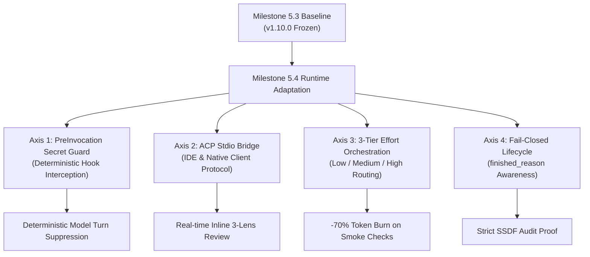

# Milestone 5.4 Phase 1 Planning Proposal: Next-Generation Runtime Adaptation & Multi-Tier Governance

**Document Version**: `1.0.0-PROPOSAL`  
**Milestone Scope**: Milestone 5.4 — Runtime Evolution, Pre-Invocation Deterministic Interception & Multi-Tier Governance  
**Governance Framework**: NIST SSDF (SP 800-218) / NIST SP 800-53 / Default-Deny Authority Invariant  
**Target Release**: `v1.11.0`  
**Authoritative Context**: Builds directly upon frozen Milestone 5.3 baseline (`v1.10.0`) and Antigravity CLI 1.5.1 runtime capabilities.

---

## 1. Milestone 5.4 Strategic Objectives

Having achieved mathematical closure and 112-round double-blind audit freeze in Milestone 5.3, Milestone 5.4 transitions from *internal validation convergence* to *runtime-level enforcement and performance optimization*.

---

## 2. Four Technical Workstreams for Phase 1

### Workstream 1: Native PreInvocation Security Hook
- **Background**: Antigravity CLI v1.5.1 introduced `terminationBehavior: "terminate"` for `PreInvocation` hooks, enabling scripts to reject turns *before* prompt tokens are transmitted to the LLM upon detecting credentials.
- **Implementation Goal**:
  1. Register a native `PreInvocation` hook (`hooks/pre-invocation-secret-guard.mjs`).
  2. Implement local high-speed regex scan for high-entropy secrets, private keys (`BEGIN PRIVATE KEY`), and unmasked cloud credentials.
  3. Enforce deterministic rejection (`terminationBehavior: "terminate"`, subprocess exit status 0 with LF-only JSON output per subprocess contract) when secrets are detected.
  4. **Value**: Deterministic model turn dispatch suppression upon rule match under fail-closed credential containment.

### Workstream 2: Agent Client Protocol (`agy acp`) Native Integration
- **Background**: AGY 1.5.1 provides the Agent Client Protocol (`agy acp`), a standardized JSON-RPC 2.0 stdio protocol for IDE and client integrations.
- **Empirical Architectural Decision (M54-P1-F04 Closure)**:
  1. **Native Priority**: Direct integration with the native `agy acp --stdio` server. No external custom bridge layer (`acp-stdio-bridge.mjs`) is required because native ACP already supports full session lifecycle (`loadSession`, `session/new`, `session/list`, `session/update`) and dynamic model/effort configuration (13 distinct model/effort profiles).
  2. **Protocol Boundary Distinction**:
     - **Real-Time Editor Interface Protocol**: Native ACP JSON-RPC 2.0 over stdio.
     - **Static Analysis & Compliance Exchange Format**: SARIF 2.1.0 standard.
     - SARIF is an archival and exchange format, never an interactive editor communication protocol.
  3. **Verification**: Live JSON-RPC handshake, capability negotiation, and session creation verified empirically and captured in `docs/rfcs/0004-acp-native-protocol-spike-report.md` and `evals/protocols/acp-stdio-probe-record.json`.

### Workstream 3: Formalized 3-Tier Effort Orchestration (`low` | `medium` | `high`)
- **Background**: Verified live across `SEM-01` and `SEM-08`:
  - `Low`: 19.8s latency, 0 thinking tokens, -70.8% total tokens (Smoke/Pre-commit).
  - `Medium`: 52.9% fewer thinking tokens, 100% semantic fidelity, strict JSON compliance (Standard CI).
  - `High`: Maximum reasoning depth, exhaustive static traces (Pre-release gate).
- **Implementation Goal**:
  1. Update `plugin.json` and `SKILL.md` to expose explicit `--effort` routing flags.
  2. Embed robust markdown fence unwrapping in all tool ingestion pipelines.
  3. Document effort-level guidelines in official plugin documentation.

### Workstream 4: Fail-Closed `finished_reason` Lifecycle Governance
- **Background**: AGY 1.5.1 stream JSON telemetry surfaces `finished_reason: "print_timeout" | "error" | "interrupted" | "complete"`.
- **Implementation Goal**:
  1. Update `record-benchmark-run.mjs` and `finalize-scan.mjs` to ingest `finished_reason`.
  2. Treat all non-complete reasons strictly as `CENSORED_EXPOSURE` under NIST SSDF.
  3. Prohibit silent fallback or negative imputation on timed-out passes.

---

## 3. Gate 0: CLI Contract, Data Coverage & Authority Invariants (Independent Reviewer R1 Binding Mandate)

Following Independent Third-Party Reviewer (ChatGPT) Verdict `M54-P1-ARCH-REVIEW-R1 = CONDITIONAL_ACCEPT`, the following 5 Open Findings constitute the mandatory **Gate 0 Entry Criteria** before any feature promotion into production branches:

### Core Governance Invariant
$$\text{EXECUTION\_COMPLETE} \ne \text{FINDING\_VERIFIED} \ne \text{RELEASE\_AUTHORIZED}$$
*Execution completion does not imply finding verification, and finding verification does not imply release authorization.*

### Mandatory Gate 0 Checklist

| Finding ID | Severity | Invariant / Precondition Specification |
| :--- | :--- | :--- |
| **`M54-P1-F01`** | **Critical** | **PreInvocation Hook Fail-Closed**: Hook must specify exact input sources covered (`lastUserInput`); fail-closed on hook error, timeout, or missing context; prohibited from claiming absolute "zero-token leak prevention" (restated as "deterministic model turn suppression upon rule hit"); real secrets prohibited in testing. |
| **`M54-P1-F02`** | **High** | **`finished_reason` Omission Handling**: Antigravity CLI omits `finished_reason` on normal completion; success must be evaluated via exit code 0, complete result event, and schema validity; non-zero exit, timeout, or interruption must be classified strictly as `CENSORED_EXPOSURE`, never `CLEAN`. |
| **`M54-P1-F03`** | **High** | **RFC 0003 Authority Promotion Inheritance**: 3-tier reasoning profiles (`low` / `medium` / `high`) cannot bypass RFC 0003 Authority Promotion Protocol (Internal -> External -> Shadow -> Blocking). - *Allowed State Transitions*: `RAW_CANDIDATE (Low/Medium/High) -> UNVERIFIED -> 3-Lens Verification Panel -> REPORTABLE`. - *Prohibited Transitions*: Direct promotion from `RAW_CANDIDATE -> REPORTABLE` is strictly rejected fail-closed; self-asserted `CONFIRMED` status is downgraded to `DEFERRED` (`NEEDS_MANUAL_REVIEW`). - Verified via negative unit test suite `tests/test-effort-authority-promotion-invariants.mjs`. |
| **`M54-P1-F04`** | **Medium** | **Native ACP Prioritization**: Prioritize native `agy acp` stdio server (Antigravity ACP Server 1.5.1); custom bridge layers rejected in favor of native protocol integration; editor squiggles require independent UI verification; verified with reproducible probe trace `evals/protocols/acp-stdio-probe-record.json`. |
| **`M54-P1-F05`** | **Medium** | **Audit Traceability**: RFC 0004, baseline commit `d1e5e1a`, and empirical benchmark traces across all evaluated models must maintain immutable cryptographic provenance and reproducible execution hashes. |

---

## 4. Phase 1 Execution Roadmap & Gate Criteria

| Phase Step | Target Deliverable | Verification Gate |
| :--- | :--- | :--- |
| **Gate 0: Contract Verification** | Gate 0 Invariant Checklist Sign-off | All 5 OPEN findings verified against CLI specifications and regression tests (test:hooks 13/13, test:lifecycle 10/10, test:authority 26/26). |
| **Step 1: Hook Architecture** | `hooks/pre-invocation-secret-guard.mjs` + `plugin.json` hook definition | Deterministic model turn dispatch suppression upon rule match verified via fail-closed `terminationBehavior: "terminate"` (`tests/test-pre-invocation-secret-guard.mjs` passes 13/13). |
| **Step 2: Effort Wiring** | `skills/security-audit/SKILL.md` update + CLI parameter schema update | `npm test` and `agy plugin validate . --strict` return 0 findings. |
| **Step 3: Lifecycle Hardening** | `finished_reason` telemetry ingestion in `record-benchmark-run.mjs` | Multi-pass runner classifies simulated timeouts/truncation and non-allowlisted finished reasons as `CENSORED_EXPOSURE` (`tests/test-finished-reason-governance.mjs` passes 10/10). |
| **Step 4: ACP Native Integration** | `docs/rfcs/0004-acp-native-protocol-spike-report.md` | Native `agy acp --stdio` JSON-RPC 2.0 handshake, session lifecycle, and 13-model matrix verified with `evals/protocols/acp-stdio-probe-record.json`. |

---

## 5. Resource & Quota Allocation Strategy

- **Token Consumption**: Phase 1 is primarily architectural, hook engineering, and adapter implementation. Live token usage is virtually zero (unit tests execute with `--mock` or offline harnesses).
- **Quota Impact**: Zero risk to weekly or 5-hour quota pools.
- **Compatibility**: 100% backwards-compatible with `v1.10.0` baseline.
