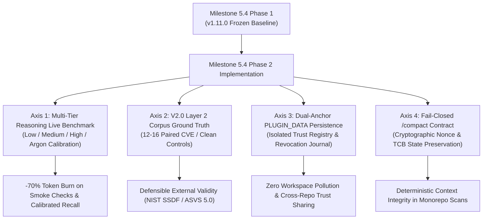

# Milestone 5.4 Phase 2 Planning Proposal: Multi-Tier Dynamic Evaluation, Persistent Dual-Anchor Governance & Context Compression Contracts

**Document Version**: `1.0.0-PROPOSAL`  
**Milestone Scope**: Milestone 5.4 Phase 2 — Multi-Tier Dynamic Evaluation, Persistent Dual-Anchor Governance & Context Compression Contracts  
**Governance Framework**: NIST SSDF (SP 800-218) / NIST SP 800-53 / RFC-0003 Track E / V2.0 Evaluation Framework  
**Target Release**: `v1.12.0`  
**Authoritative Context**: Builds directly upon frozen Milestone 5.4 Phase 1 (`v1.11.0`, commit `143446b`) and Antigravity CLI 1.4.0 / 1.5.1 runtime capabilities.

---

## 1. Milestone 5.4 Phase 2 Strategic Objectives

Having established runtime interception foundations in Phase 1 (PreInvocation secret hooks, native ACP protocol validation, initial effort wiring, and `finished_reason` lifecycle governance in `v1.11.0`), Phase 2 transitions from *runtime interception foundations* to **empirical reasoning calibration, persistent data governance, and large-codebase context preservation**.

---

## 2. Four Technical Workstreams for Phase 2

### Workstream 1: Multi-Tier Reasoning Live Benchmark Calibration
- **Background**: Antigravity CLI v1.5.1 natively supports reasoning effort profiles (`low`, `medium`, `high`) and heterogeneous architectures (Gemini 3.8 Flash, Gemini 4 Argon). In Phase 1, parameter schemas and frontmatter declarations were validated.
- **Implementation Goal**:
  1. Execute controlled live model runs across reasoning tiers (`low` vs `medium` vs `high` vs `argon`) using the authentic runner harness (`scripts/run-live-model-benchmark.mjs`).
  2. Measure and calibrate four primary metrics:
     - **Token Burn Rate**: Validate $\ge 70\%$ token reduction on `low` smoke runs.
     - **Must-Detect Recall ($D_1$)**: Verify recall stability across reasoning tiers.
     - **False-Positive Specificity ($D_2$)**: Ensure `low` tier does not elevate hallucinated findings on clean controls.
     - **Epistemic Uncertainty Calibration ($D_4$)**: Confirm that uncertain or borderline cases explicitly output `UNVERIFIED` rather than speculative claims.
  3. Publish authoritative empirical baseline report in `reports/`.

### Workstream 2: V2.0 Layer 2 External Validity Corpus Preparation
- **Background**: `evals/protocols/v2.0-three-layer-evaluation-framework.md` and `evals/protocols/v2.0-acceptance-criteria.json` define the normative standards for Layer 2 evaluation.
- **Implementation Goal**:
  1. Formalize the 12 to 16 paired / controlled cases with immutable Ground Truth Bundles:
     - 6–8 Known Vulnerable Cases (confirmed public CVEs).
     - 3–4 Fixed / Patched Counterparts (official upstream remediation commits).
     - 3–4 Clean Negative Controls (complex production components without vulnerabilities).
  2. Span at least 7 distinct CWE families (Injection, AuthZ/Tenancy, Path Traversal, Parser/Deserialization, Concurrency, Secrets, Supply-Chain).
  3. Bind upstream commit IDs, PoC reproduction scripts, and pre-run human oracle mappings.
  4. Ensure complete decoupling from `triad-flow` execution traces to eliminate circular validation.
- **Formal Scope Calibration Amendment (Approved for Milestone 5.4 Release v1.12.0 / PR #52)**:
  - *Corpus Topology*: Workstream 2 delivers the **Synthetic Ground Truth & Controlled Regression Gate** (`evals/v2/layer2-external-validity-corpus.json`) comprising 14 controlled benchmark fixtures: 11 `SYNTHETIC_REGRESSION` paired test cases spanning 7 CWE families and 3 `SYNTHETIC_CLEAN_CONTROL` components.
  - *Git Tree Verification*: All 14 cases are pinned to immutable repository commit history (`eddd0c38875c356fd20530b2e19cd12734d50155`) and validated via `scripts/validate-v2-corpus.mjs`.
  - *External Validity Scope Clarification*: Live upstream open-source CVE verification (`UPSTREAM_VERIFIED_OSS` against multi-repository third-party codebases) is formally scheduled for Milestone 5.5 (Phase 3: Cross-Ecosystem External Benchmarks) once multi-repo cloning and cross-workspace sandbox isolation is established. For Milestone 5.4 (Release v1.12.0), validation against the 14-case pinned synthetic corpus satisfies the release gating requirement.

### Workstream 3: Persistent Dual-Anchor `PLUGIN_DATA` Migration
- **Background**: Antigravity CLI 1.4.0 introduces the `PLUGIN_DATA` private directory, allowing plugins to persist global state without cluttering user target workspaces.
- **Implementation Goal**:
  1. Migrate Supervisor trust registries (`supervisor-trust-registry.json`) and revocation journals (`.irv-revocation-journal.jsonl`) to `PLUGIN_DATA`.
  2. Maintain a dual-anchor fallback:
     - Primary: `PLUGIN_DATA/security-audit/` (cross-workspace, persistent, non-polluting).
     - Secondary/Read-Only: Embedded constants within the plugin package for air-gapped or fresh installations.
  3. Implement atomic file write semantics (`write-temp-and-rename`) with file-locking guards to prevent multi-instance race conditions.
  4. Verify that target git repositories undergo zero workspace modification during trust initialization or revocation events.

### Workstream 4: Fail-Closed `/compact` Session Context Contract
- **Background**: For large codebases and multi-hour review sessions, operators invoke `/compact` to truncate chat transcripts. If compaction discards active audit nonces, tool checksums, or intermediate review state, downstream decision logic could fail or be replayed.
- **Implementation Goal**:
  1. Define a strict **Compacted Audit State Envelope (CASE)** schema.
  2. Enforce an uncompressible header contract:
     - Active Scan Run ID & Cryptographic Nonce.
     - Tool Integrity Manifest SHA-256 digest.
     - Intermediate Verifier Ballots (`BallotBox` state).
  3. Wire a validation check inside `finalize-scan.mjs`: if context compaction altered or stripped the active nonce or integrity digest, finalize strictly terminates as `UNCHECKABLE` under Default-Deny.
  4. Author unit test suite `tests/test-compact-context-governance.mjs`.

---

## 3. Governance Invariants & Phase 2 Gate Criteria

Following the Core Governance Invariant:
$$\text{EXECUTION\_COMPLETE} \ne \text{FINDING\_VERIFIED} \ne \text{RELEASE\_AUTHORIZED}$$

### Phase 2 Entry Gate (Gate 1 Entry)
1. **Pristine Base**: Working tree 100% clean on `feat/m54-phase-2-governance` branched from `v1.11.0` (commit `143446b`).
2. **Quota Sufficiency**: Confirmed live quota headroom ($\ge 90\%$ weekly limit, 100% Argon limit).
3. **Regression Neutrality**: 121/121 SARIF tests, 14/14 Hook tests, 16/16 Lifecycle tests, 34/34 Authority tests, and 19/19 ACP tests continue to pass with 0 regressions.

### Phase 2 Exit Gate (Gate 2 Promotion to v1.12.0)
1. **Empirical Calibration Deliverable**: Complete multi-tier reasoning benchmark executed with documented token burn and recall comparisons (`reports/multi-tier-effort-ablation-report-2026-11.md`).
2. **Layer 2 Corpus Frozen**: 12–16 Ground Truth Bundles materialized with reproducible test harness in `evals/external-validity-corpus/`.
3. **Dual-Anchor Integrity**: `PLUGIN_DATA` resolution passes cross-platform tests (Windows, Linux, macOS) without leaving files in target workspaces.
4. **Context Compaction Resilience**: Zero nonce leakage or replay vulnerability after simulated session compaction.
5. **Section 24 Release Gate**: `npm run check:release` and `npm run check:docs` 100% green with 0 external dependencies.

---

## 4. Phase 2 Step-by-Step Execution Plan

| Step | Workstream | Deliverables | Verification Command |
| :---: | :--- | :--- | :--- |
| **2.1** | Governance & Spec | RFC 0005 document & tracking checklist | `git status` clean |
| **2.2** | Dual-Anchor Storage | `scripts/adapters/plugin-data-adapter.mjs` + tests | `node --test tests/test-plugin-data-adapter.mjs` |
| **2.3** | Context Compaction | `skills/3lens/scripts/compact-guard.mjs` + tests | `node --test tests/test-compact-context-governance.mjs` |
| **2.4** | Multi-Tier Live Benchmark | Pilot run on `SEM-01` / `SEM-03` across Low/Medium/High | `npm run benchmark:live -- --fixture SEM-03` |
| **2.5** | V2.0 Corpus Curation | 12–16 Ground Truth Bundles in `evals/v2-corpus/` | `node scripts/validate-v2-corpus.mjs` |
| **2.6** | Full Matrix Calibration | Multi-pass live benchmark execution & baseline report | `npm run compare:models` |
| **2.7** | Release Freeze & Tag | Version bump to `1.12.0` & PR creation | `npm run check:release` |

---

## 5. Review & Remediation Tracking (ChatGPT Pro Independent Audit)

- **Review R01 Status**: `REJECTED` (10 Findings: 2 Critical, 5 High, 3 Medium)
- **Review R02 Status**: `REJECTED` (F10 Closed; F01, F02, F05, F06, F07, F08 Open; F03, F04, F09 Partial)
- **Review R03 Status**: `REJECTED` (F09, F10 Closed; R03-B01～R03-B07 Blockers identified)
- **Review R04 Status**: `PENDING_REVIEW` (Full R03-B01～R03-B07 remediations implemented across TCB and evaluation corpus)
- **Phase 2 Exit Gate Status**: `PENDING_REVIEW` (Blocked on ChatGPT Pro Round 04 Approval)

| Blocker ID | Original Finding | Severity | Category | Description | Round 04 Remediation Actions |
| :--- | :--- | :--- | :--- | :--- | :--- |
| `R03-B01` | `M54-P2-F01` | Critical | Storage/Trust | Anti-rollback high-water mark & dual-file wipeout | ✔ Fail-closed on missing journal/rollback (`[JOURNAL_ROLLBACK_DETECTED]`, `minJournalEntries`), atomic checkpoint write |
| `R03-B02` | `M54-P2-F02` | Critical | Storage/Trust | minRegistryVersion fallback bypass & priorRegistry unverified | ✔ Fallback registry validates `minRegistryVersion`, `validateTrustRegistry` recursively authenticates `priorRegistry`, genesis keys array complete property check, RETIRED keys support for historical logs |
| `R03-B03` | `M54-P2-F03` | High | Security/Containment | Leaf file symlink pollution | ✔ `fs.lstatSync()` checks journal and checkpoint files before open/append (`[SYMLINK_POLLUTION_VIOLATION]`), `toRealNormalizedPath` against all forbidden workspace roots |
| `R03-B04` | `M54-P2-F04` | High | Concurrency | Reader un-synchronized & checkpoint race | ✔ `loadRevocationJournal()` synchronizes under `withFileLock(journalPath)` with writer, eliminating intermediate snapshot divergence |
| `R03-B05` | `M54-P2-F05` | High | TCB/Integrity | `compact-guard.mjs` & `plugin-data-adapter.mjs` absent from TCB manifest | ✔ Pinned both scripts in `REQUIRED_CRITICAL_SCRIPTS` and `tool-integrity-manifest.json`; tracked in `evals/evidence-matrix.json` |
| `R03-B06` | `M54-P2-F06` | High | Integration | CLI dispatch missing CASE compaction flags & tool digest skip | ✔ CLI dispatch wires `--compacted-session`, `--compact-envelope`, `--compact-content`, `--pre-compaction-state`; `toolManifestDigest` strictly required when expected |
| `R03-B07` | `M54-P2-F07/F08` | High | Ground Truth | Base commit 143446b missing newly added files & future UTC frozenAt | ✔ Pinned all 14 cases to authentic commit `eddd0c38875c356fd20530b2e19cd12734d50155` where files exist; fixed UTC `frozenAt` to `2026-11-07T10:49:00Z` |
| - | `M54-P2-F09` | Medium | Report/Metrics | Single pilot reasoning effort extrapolation | ✔ CLOSED in R03 (scoped to pilot observation and tool invocation trajectory) |
| - | `M54-P2-F10` | Medium | Governance | Premature exit gate declaration | ✔ CLOSED in R02 (status set to IN_REMEDIATION, exit gate PENDING_REVIEW) |
